# アーキテクチャ

最終確認: 2026-10-14。現行のソースコードと設計判断を基に、通常ワークスペースと
実験的YM2203音源の構成を説明する。図はMermaid形式で、対応するMarkdownビューアーでは
図として表示できる。リンク先のADRには過去の制限値も残るため、現在値は本書の表と実装を参照する。

## 目的と範囲

MicroPython Web Labは、利用者が入力したMicroPythonコードをブラウザ内で実行し、Raspberry Pi Pico 2 Wと
外付けデバイスの機能レベルの動作を試せる静的Webアプリケーションである。命令単位、クロック単位、
電気特性を再現するエミュレーターではない。

実行基盤、UI、仮想ボード、Device Model、接続設定を分離し、応答しない利用者コードから画面を復旧できる
ことを設計の中心に置く。信頼境界と既知の制約は[脅威モデル](threat-model.md)を参照する。

MicroPythonプロジェクト、Raspberry Pi、Yamaha等の公式製品ではない。
YM2203対応では独立した音声実行領域を追加した。これは通常のDedicated Web Workerではなく、
Web Audioの`AudioWorkletProcessor`である。MicroPython用WASMと音源用WASMは別インスタンスで動作し、
Python実行とPCM生成の時計・状態・停止責務を分離する。

## 全体構成

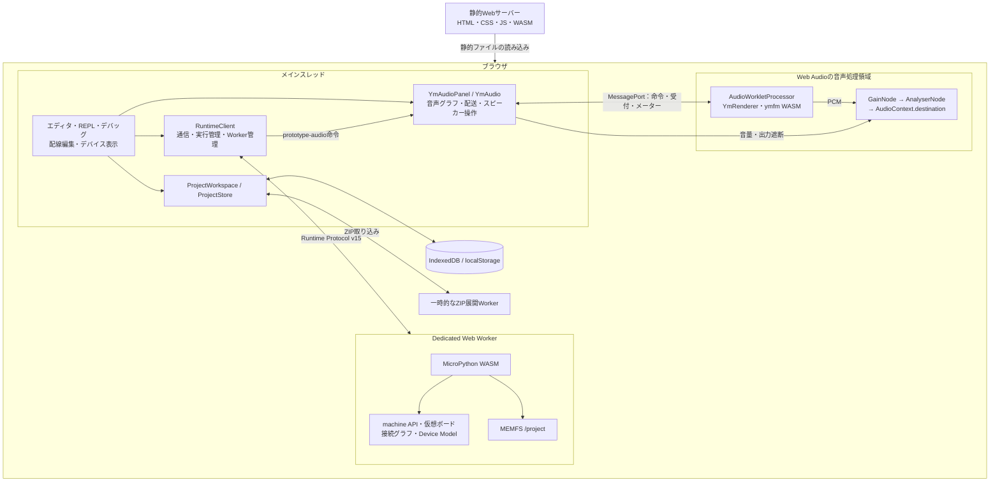

Webサーバーは静的ファイルを配信するだけで、利用者のPythonコードをサーバー側では実行しない。
MicroPythonとDevice ModelはDedicated Web Worker内で動作し、DOMを直接操作しない。

### 実行領域の違い

| 実行領域 | 所有する処理・状態 | 起動と終了 |
| --- | --- | --- |
| メインスレッド | DOM、編集バッファ、復元用ファイル状態、保存、RuntimeClient、音声ホスト | ページの生存期間 |
| MicroPython Worker | Python変数、importキャッシュ、仮想デバイス、実行用MEMFS | 起動・リセットで生成し、停止時に破棄 |
| AudioWorklet | 音源レジスタ、予約イベント、サンプル時計、PCM生成 | 通常画面では音源結線に合わせて準備し、切断時にAudioContextごと終了 |
| ZIP Worker | ZIPの展開・検証 | 取り込みごとに生成し、終了・失敗・時間超過で破棄 |

`ym2203.worklet.ts?worker&url`はViteによるバンドル指定である。実行時は
`audioWorklet.addModule()`と`new AudioWorkletNode()`で起動し、`new Worker()`は使用しない。
ブラウザ内部のOSスレッド数や割り当ては本アプリでは制御しない。
MicroPython WorkerとAudioWorkletはメインスレッドを介して命令を交換し、PCMリングバッファを共有しない。

### 主なソースの責任

| 層 | 実装 | 責任 |
| --- | --- | --- |
| アプリ統合 | [`src/main.ts`](../src/main.ts)、`src/layout/` | 操作イベントと各機能の接続、表示切り替え |
| 実行境界 | [`client.ts`](../src/runtime/client.ts)、[`protocol.ts`](../src/runtime/protocol.ts) | 実行所有権、メッセージ検査、上限、Workerの生存管理 |
| MicroPython | [`micropython.worker.ts`](../src/runtime/micropython.worker.ts)、[`vendor/micropython.ts`](../src/vendor/micropython.ts) | WASMロード、REPL、通常・デバッグ実行、許可モジュール登録 |
| 仮想ハードウェア | `src/board/`、`src/connections/`、`src/simulation/`、`src/device-api/`、`src/devices/` | ボード資源、接続検証、同期API、Device Model |
| デバイス表示 | `src/device-ui/` | 宣言的UIと順序付き状態通知の描画 |
| プロジェクト | `src/project/`、[`runtime/project-filesystem.ts`](../src/runtime/project-filesystem.ts) | 下書き・ファイル・IndexedDB・MEMFS・ZIP |
| 音声ホスト | [`ym2203-panel.ts`](../src/audio/ym2203-panel.ts)、[`ym2203-audio.ts`](../src/audio/ym2203-audio.ts) | 結線連動、音声グラフ、配送確認、ミュート・音量 |
| 音声処理 | [`ym2203.worklet.ts`](../src/audio/ym2203.worklet.ts)、[`ym2203-renderer.ts`](../src/audio/ym2203-renderer.ts)、[`wrapper.cpp`](../runtime/ymfm/wrapper.cpp) | 予約実行、音源合成、再標本化、PCM出力 |

UIはTypeScriptとDOM操作で実装し、Viteでビルドする。現行`package.json`の本番依存パッケージは空で、
UIフレームワークは導入していない。MicroPythonへの直接アクセスはWorker側へ集約する。

## 実行環境とWorker境界

MicroPythonは固定した公式リリースとEmscripten版から、制限付きvariantとしてビルドする。汎用JavaScriptへ
到達する`js`、`jsffi`、JavaScript hookと、任意ネットワークに使えるモジュールは公開しない。Web Labが
登録する`machine`とデバッガ用モジュールだけを明示的な橋として扱う。

メインスレッドの`RuntimeClient`はWorkerを使い捨て可能な実行単位として管理する。手動停止はWorkerを破棄して
`stopped`へ移り、再起動操作で生成する。任意設定した実行時間超過、出力量超過では自動再生成する。
予期しないWorkerエラーも回数を制限して自動復旧する。エディタ内容や接続設定の正本を
Worker内だけに置かないため、実行状態を失っても画面全体を再読み込みせず復旧できる。

UIとWorkerの通信には、版と型を持つ制御メッセージを使用する。REPLの標準入出力は制御状態と分離し、
未知のメッセージ、不正な値、古いWorkerからの応答をメインスレッドで拒否する。

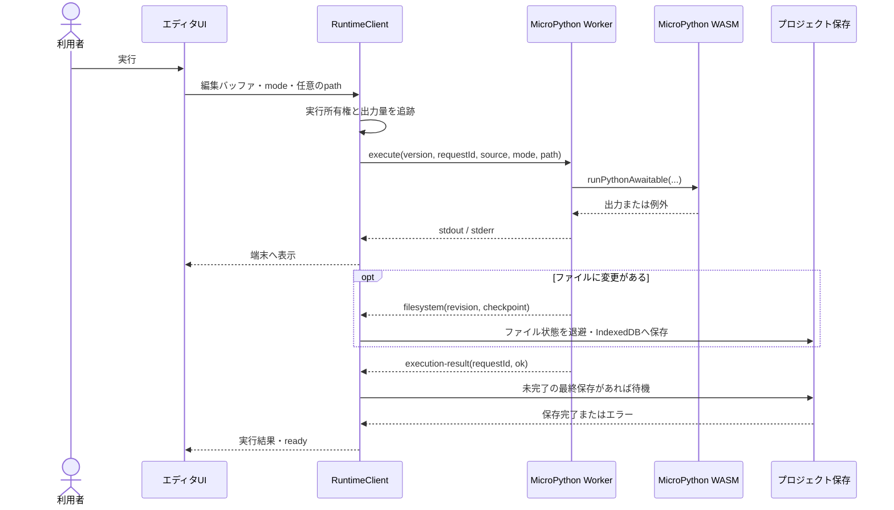

実行は編集バッファを渡すため、ファイル保存を前提としない。importと`open()`はMEMFSへ同期された
保存済みファイルを使う。通常実行にはトレースを常時設定せず、デバッグモードだけ別の入口を使う。
Asyncify対応の実行APIとREPL APIを使用し、REPL入力はPromiseキューで直列化する。

Runtime Protocolは現在v15で、実行要求・結果は`requestId`を持つ。REPLの処理開始と完了も
`repl-executing`／`repl-ready`として要求IDを照合する。端末に表示されたプロンプト文字列だけで
処理完了を判定しない。ファイル通知は単調増加revisionを持ち、旧Workerの応答や順序が後退した通知を拒否する。
`stdout`／`stderr`と、`execution-result`、リセット、デバッグ、音声などの制御イベントは別メッセージである。

空のREPL主プロンプトでCtrl+Dを入力した場合は、WASMの終了要求を`repl-reset`制御イベントへ変換し、
Workerを再生成する。Python変数とWorker内の状態は失うが、エディタ・配線設定と共有入力領域は保持する。
ボタンの押下状態は従来の再起動と同様に解除する。複数行入力の完了にはリセットを発生させない。

標準出力・標準エラーはWorker内で改行または4,096文字までまとめ、制御イベントの前と入力処理の終了時にも
転送する。1入力メッセージまたは1スクリプトあたり合計100,000文字を超えると、`output-limit`を一度通知して
以降の出力を破棄する。メインスレッドの出力量制限も維持し、端末のDOM描画はフレームごとにまとめる。
アルファ版はスクリプト・REPL・デバッグ実行の時間上限を既定で無効とする。
`RuntimeClientOptions.executionLimitMs`の省略または`null`は無制限、正の整数はホストの時限監視を有効にする。
監視を設定した場合は、従来どおりデバッガ待機・保存完了待ちを除いた経過時間を累積する。
無限ループは手動停止までCPUを消費するが、Worker破棄と再起動は期限に依存しない。
変更理由と影響は[ADR 0045](adr/0045-disable-the-default-execution-deadline-for-alpha.md)を参照する。
詳細と通信版の移行は[ADR 0033](adr/0033-recover-repl-reset-and-output-floods.md)を参照する。

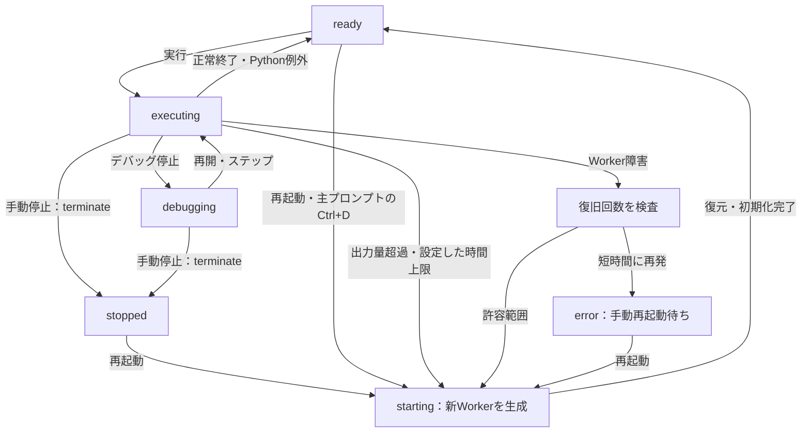

予期しないWorker障害の自動復旧は30秒以内に1回までとし、連続する読み込み失敗等で無限再起動しない。
Worker再生成はPython変数・importキャッシュ・デバイス内部状態を初期化する。
音源接続時はUIの状態変更処理が音声も停止するため、Worker破棄だけで予約演奏を残さない。

## 同期入力

MicroPythonが同期的なPythonコードを実行している間、Workerの通常のメッセージループは入力イベントを
処理できない。ボタン、ADC、UARTなど、実行中にも変更する必要がある許可済み入力は、版付きかつ上限付きの
`SharedArrayBuffer`を介して共有する。

共有領域は名前、値域、形式版、容量を起動時に検証する。PythonコードとDevice Modelには共有バッファ自体を
渡さず、Device Hostが検証済みのスカラー値、キュー、Device Actionへ変換する。共有メモリを利用できない
環境では同期入力とデバッグ実行を無効にし、通常のREPLと出力観測は可能な範囲で維持する。

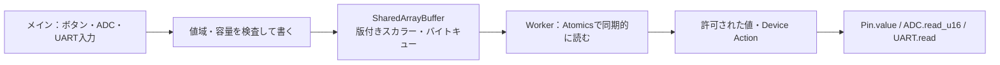

共有メモリは同期デバイス入力、デバッガコマンド、ファイル通知の確認フラグという限定用途に使う。
オーディオ命令の転送はMessagePortを使い、この共有入力領域へPCMを格納しない。

## 仮想ボード、接続、デバイス

Board ProfileはPico 2 Wのピン、ADC、I2C、SPI、UART、PWMなどの資源を解決する。Device Modelは特定の
DOMやボード実装へ依存せず、論理ポートを通してGPIO、ADC、バス、PWMの同期動作を提供する。

`ConnectionGraphV1`はDevice ModelのポートとBoard Profile上のピン・バスを対応付ける。接続グラフは
Device Model生成前に検証し、未対応ピン、GPIO競合、I2Cアドレス重複、SPI CS競合などを拒否する。I2Cのように
同一controllerへ複数デバイスを接続できる資源は、共有信号とデバイス固有資源を分けて検査する。形式の詳細は
[接続モデル仕様](connection-model-v1.md)を参照する。

Device UIは許可リスト方式の宣言的な部品から固定DOMを生成する。Device ModelへDOM、ストレージ、
任意ネットワーク、汎用JavaScriptブリッジを渡さない。UI表示用の状態とシミュレーション状態は別の値として
扱い、状態通知には順序番号と容量上限を持たせる。第三者Device Model向けの契約は
[Device API v1仕様](device-api-v1.md)を参照する。

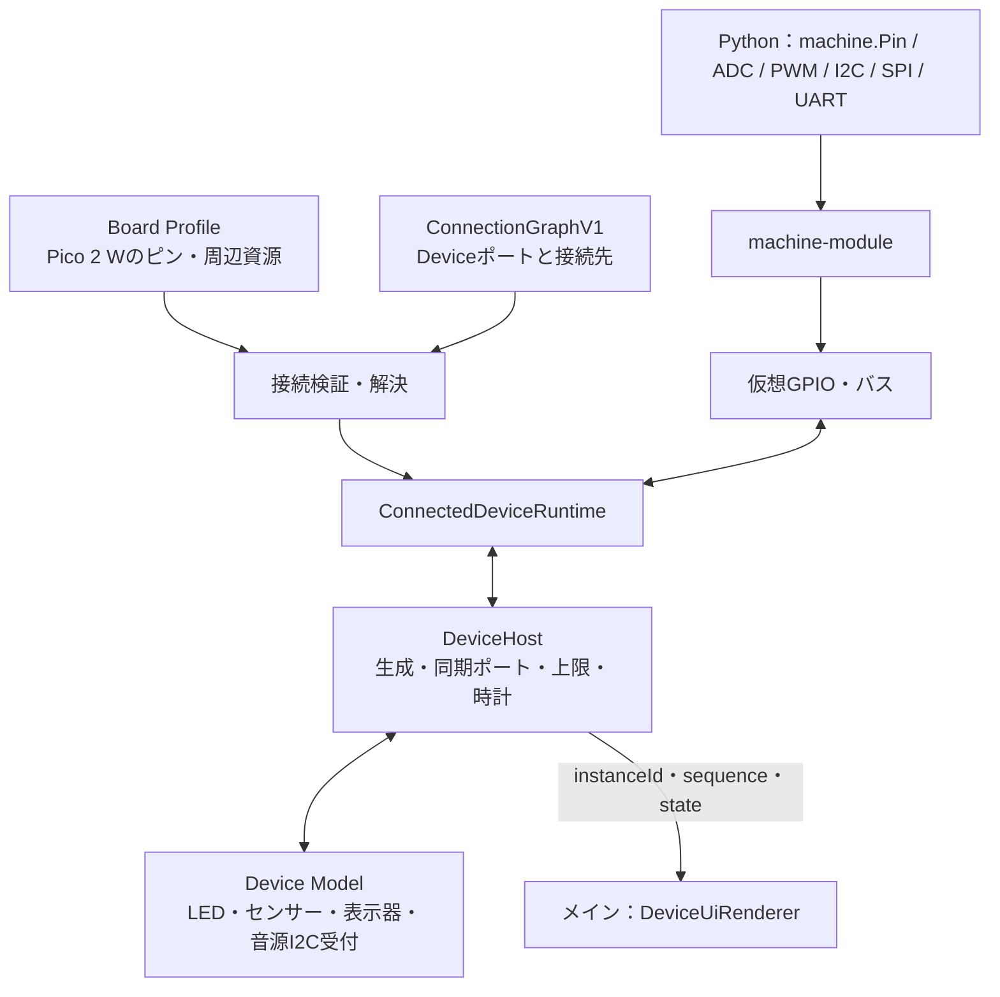

例えばI2Cのレジスタ読み取りは、machineラッパー、仮想I2Cバス、接続先のI2C target portを経由し、
モデルの値をPythonのバイト列へ変換する。PWMは周期ごとの波形を生成せず、正規化した設定変更を通知する。
DeviceHostは単調増加の時計を提供し、テストでは手動時計に交換できる。
YM2203はこの機能モデルに音声sinkを付加したホスト管理の実験経路であり、公開Device API v1へ
AudioContextや音声ポートを追加したものではない。

## ワークスペースの表示境界

ワークスペースはファイルツリー・サンプル、エディタ・REPL、仮想デバイスの3列で構成する。
構成・配線の専用ビューへの移動はCSSとDOMの表示だけを変更し、エディタ、REPL、接続エディター、
RuntimeClientを再生成しない。配線の適用によるWorker再生成は従来の経路を利用する。
ファイル・エディタ・接続設定の保存形式、Worker通信、Device APIの契約はこの配置変更では変えない。

中央と右の幅の保存比率はファイルペインを除く領域に適用する。配線エディターは、専用ビューの
スクロール領域を基準にPico端子表の追随と結線端点の表示を計算する。デバイスカードの
折りたたみは表示用の状態だけであり、モデルの実行と状態通知を止めない。

## エディタ、REPL、デバッグ

`CodeEditorView`はtextareaを正本としてPythonのキーワード・文字列・コメントを`textContent`で
色分けし、行番号とフォーカス中のカーソル行を表示する。縦横スクロールを入力欄へ合わせ、
表示レイヤーによって入力・保存・Tab操作を変更しない。構文解析や文字列内の式の色分けは行わない。
実験画面の狭い表示でも入力欄と色分けに同じフォントサイズ・行高を使用する。

現行のWorker通信はv15で、pdbの`break`／`clear`による変更を`debugger-breakpoints`で通知する。
実行IDとデバッグ停止状態を検査した上で行番号欄へ赤い丸を表示し、停止行には黄色い矢印を併記する。
ブレークポイントは再開中も維持し、実行終了・Worker再生成では消去する。保存形式は変更しない。
詳細とv14からの更新方針は[ADR 0036](adr/0036-add-editor-highlighting-and-breakpoint-markers.md)を参照する。

コードエディタは複数タブを扱い、ブラウザ内の版付き保存形式へ下書きを保存する。仮想デバイスのサンプルは
既存コードを上書きせず、パスを持たない「無題」タブとして追加する。すべてのタブの自動保存は復元用の
下書きだけを更新し、ファイル本体へ反映しない。実行はバッファを渡し、importとopenは保存済みファイルを
使う。ZIP出力でもバッファをファイルへ反映しない。明示的な保存時に、ファイルとタブの紐づけを
同じIndexedDBトランザクションで保存し、成功後に画面とWorker側のファイル一覧を更新する。
既存の初期・旧形式ワークスペースの取り込み時だけ、従来のファイル名割り当てを維持する。保存形式は変更しない。

ファイル操作はツリーの選択と操作ごとの入力ダイアログを使う。名前変更は同じ親の中で行い、
ディレクトリ作成は選択中のディレクトリへ追加し、ファイル選択時はその親へ追加する。
移動は既存のディレクトリから移動先を選び、名前を保ったままProjectFiles.renameで子孫とタブのパスを
更新する。移動元自身とその子孫は候補から除き、実行時にも移動先と同名項目の有無を確認する。
ファイルツリー内のファイルはHTMLのドラッグ＆ドロップでもディレクトリ行またはルートへ移動できる。
ドラッグ元はツリーの表示状態で保持し、外部のドロップデータだけで移動を開始しない。ドロップ時は
「移動」ボタンと同じ処理を使い、実行中や保存中はドラッグを解除して移動を無効にする。
`/project`は選択できるが名前変更・移動・削除できない。
ファイルと空ディレクトリは直接削除し、空でないディレクトリだけ子孫を含む削除の確認を求める。
ProjectFilesの再帰削除は明示指定時だけ有効とし、通常のremoveは空でないディレクトリを拒否する。
変更はファイルと開いているタブをまとめて永続化してから反映する。新規ファイル操作はパスのない無題タブを開く。

タブの未保存表示と閉じる確認は、保存に成功したファイル内容との比較で判定する。ProjectWorkspaceは
IndexedDBへ書き込み中のファイルと、最後に保存できたファイルを分けて保持し、保存失敗で未保存表示を
消さない。テキストエリアの改行正規化は変更とみなさない。無題タブは空でも確認し、下書きを自動保存しても
ファイル未保存の状態を維持する。名前のあるタブも下書きの退避では未保存表示を消さない。
変更を破棄して閉じる場合は下書きだけを除去し、ファイル本体を維持する。IndexedDBのfilesystemとtabsを
分けて復元し、新しいlocalStorage退避記録もtabsだけに適用する。初回の旧形式取り込み以外で下書きを
ファイルへ昇格させない。保存形式は変更しない。

REPLは出力画面モデルと不可視のブラウザ入力要素を分ける。MicroPython側を入力・履歴の正本とし、
ブラウザは確定した文字と制御キーだけをWorkerへ送る。応答しない実行中の停止は、MicroPythonの協調動作に
依存せずWorker再生成として扱う。

デバッグ実行は通常実行と明示的に分ける。安定版MicroPythonで利用できる`sys.settrace()`を用い、pdbに近い
コマンドとGUI操作を同じコマンド経路へ送る。停止位置と上限付きグローバル変数スナップショットをUIへ表示し、
デバッグ停止中は実行中ソースとの対応を保つ。

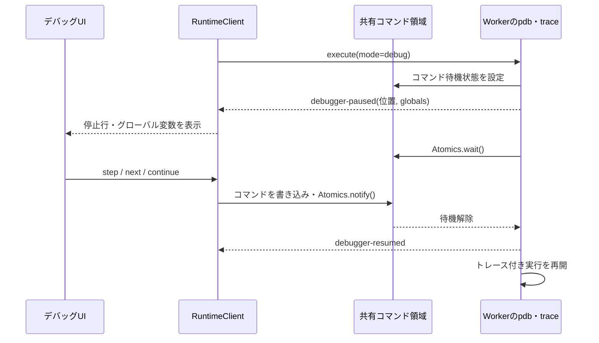

GUIボタンとpdb風コマンドは同じ共有チャネルへ送る。コマンドはUTF-8で4,096バイトまで、
グローバル変数表示は100件までとし、名前・型・値の文字数も制限する。
ステップ対象は選択中ソースで、import先のステップや関数ローカル変数の取得には制約がある。
任意設定した実行時間監視はデバッグ待機中に停止する。`quit`はWorker再生成として扱う。
デバッグ停止自体はAudioWorkletの予約時計を停止しない。演奏を破棄する場合は明示停止を使う。

## 永続プロジェクトとZIP

ファイル保存・復元はメインスレッドが管理し、Worker内のMEMFSを再生成可能な実行用コピーとして扱う。
Pythonからは`/project`が初期カレントディレクトリで、importの探索先は`/project`と`/project/lib`である。
保存済みファイルを変更しても通常のimportキャッシュは更新されず、Workerの再起動で初期化する。

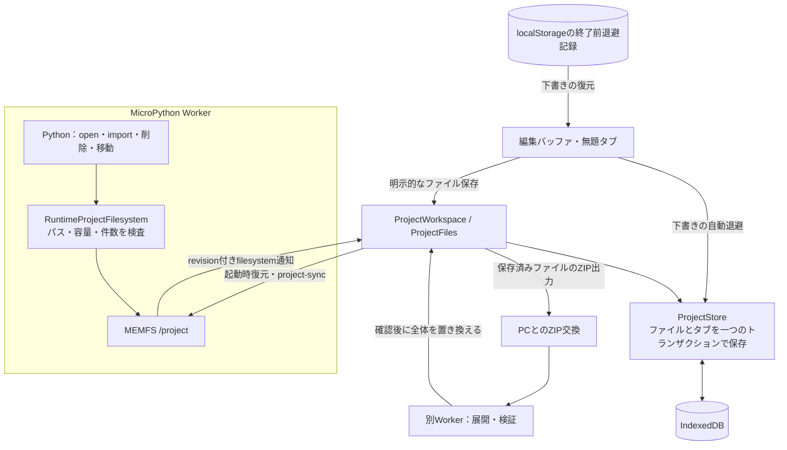

`filesystem`通知はスナップショットと単調増加revisionを持つ。通常通知は100 ms以上の間隔を空け、
SharedArrayBufferの確認フラグで未確認通知を一つに制限する。共有メモリがない場合は一操作につき
途中通知を一件に制限する。実行終了・REPLリセット時には必要な最終チェックポイントを送り、
メイン側はIndexedDBの確定を待つ。保存処理は実行中一件と最新の待機一件へ集約する。
強制停止・ページ異常終了では保存完了前の変更が失われる可能性があり、複数ウィンドウは最後の保存が優先される。

MEMFSの外部ラッパーはノード作成、サイズ増加、書き込み、削除、移動を検査する。
通常ファイルの書き込みと名前空間変更は`/project`以下に限定し、容量超過は割り当て前に拒否して
Pythonへ容量不足の`OSError`を返す。開かれたまま削除したファイルも閉じるまで容量・件数へ数える。
シンボリックリンクとmmapは提供しない。

| データ | 保持・保存先 | 再起動・ZIPとの関係 |
| --- | --- | --- |
| 保存済みファイルのバイト列 | メイン側ファイル状態・IndexedDB、実行時はMEMFS | Workerへ復元し、ZIPへ含める |
| 編集バッファ・選択中タブ | メイン側・IndexedDB、終了前のlocalStorage退避 | 下書きとして復元し、未保存分はZIPへ含めない |
| 配線・表示設定 | localStorage | 再読み込みで復元し、ZIPには含めない |
| Python変数・importキャッシュ | MicroPython Worker | 再生成で消失 |
| 音源レジスタ・予約・配送カウンター | AudioWorklet・音声ホスト | 停止で破棄し、保存・ZIPへ含めない |
| スピーカーのミュート・音量 | 音声ホストのページ内状態 | ページ再読み込みで初期値へ戻る |

ZIP出力は保存済みファイルと空ディレクトリを無圧縮ZIPとして生成する。取り込みは無圧縮・Deflateに対応し、
別Workerでパス、サイズ、CRC32、ヘッダー等を検査する。確認後に全ファイルとタブを置き換え、
コードを自動実行しない。暗号化・分割・ZIP64・特殊ファイルは対象外で、未対応のDeflate展開環境ではエラーを表示する。
基礎設計は[ADR 0035](adr/0035-add-a-persistent-project-filesystem.md)、現行の下書きとファイルの区別は
[README](../README.md#プロジェクトファイルとzip)と前節を参照する。

## 実験的FM音声経路

### AudioWorkletへ分離する理由と現在の入口

同期Python実行中は、そのWorkerのJavaScriptタイマーやメッセージループが進まない場合がある。
同じWorkerへ音声生成も置くと、Python処理に発音が妨げられる。そのため音源合成はWeb Audioの
AudioWorkletへ置き、音声処理コールバックのサンプル時計で進める。

通常ワークスペースでは、配線カタログから「YM2203音源（実験用）」を選んで接続する。
既定では未接続で、既存の保存済み配線へ自動追加しない。Device API v1と接続・保存形式は維持する。
`fm-prototype.html`は同じRuntimeClient・I2Cモデル・音声エンジンを使う独立した実現性検証ページで、
従来の「音声を有効にする」操作を残し、エディタの永続保存は行わない。
この二つの入口と同じ発音経路を区別する。

基礎設計は[ADR 0049](adr/0049-prototype-i2c-fm-audio.md)、通常画面への統合は
[ADR 0037](adr/0037-integrate-an-opt-in-sound-module.md)を参照する。

### Pythonから発音までの経路

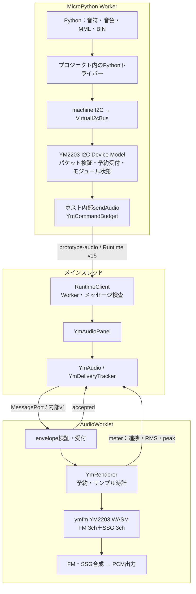

PythonにはWeb Lab独自のI2C音源モジュールとして見せる。I2C0、SDA=GP8、SCL=GP9、
7-bitアドレス`0x44`を使うが、実YM2203チップのI2C仕様を示すものではない。

[`createYm2203PrototypeDefinition`](../src/devices/ym2203-prototype.ts)は、同期I2Cパケットを
`write`（レジスタ列）、`play`（時刻付きイベント列・期間・任意のループ）、`stop`、`gain`へ変換する。
時刻付き追加パケットはモデル内の予約キューへ蓄積し、play時にまとめて音声ホストへ送る。
各I2C転送ごとにPCMを送ったり、全予約をAudioWorkletへ送り直したりしない。
キュー追加は新しいバッチと境界時刻だけを検査し、全予約の反復コピーを避ける。

Workerは接続グラフに対象インスタンスがある場合だけ、送信予算付きの音声sinkを持つモデルを登録する。
モデルの`emitState`は登録件数・I2C取引数・アンプ値などの表示用状態を通知し、
音声命令は別の`prototype-audio`イベントで送る。PCMや音声命令を一般のDevice状態へ混在させない。
Pythonと公開Device SDKへAudioContext、MessagePort、WASMメモリを渡さない。

I2Cのstatus読み取りは「まだplayされていない登録件数とアンプ値」を返す。
4バイトstatusは件数を65,535で飽和させ、6バイトstatusは32ビット件数を返す。
AudioWorkletの再生完了、実スピーカーへの出力完了、BUSYやチップレジスタ読み返しを意味しない。
詳細は[YM2203試作仕様](devices/ym2203-prototype.md)を参照する。

### 音声命令の受付と再生完了を分ける

音声ホストとWorklet間の内部配送は、v1のenvelopeへ停止世代`epoch`と命令番号`sequence`を付ける。
Workletは順序を検査し、新しい世代の最初は番号1のstopだけを認める。
命令を適用した直後の`accepted`と、音声処理が進んだ後の約10 Hzの`meter`を別々に返す。

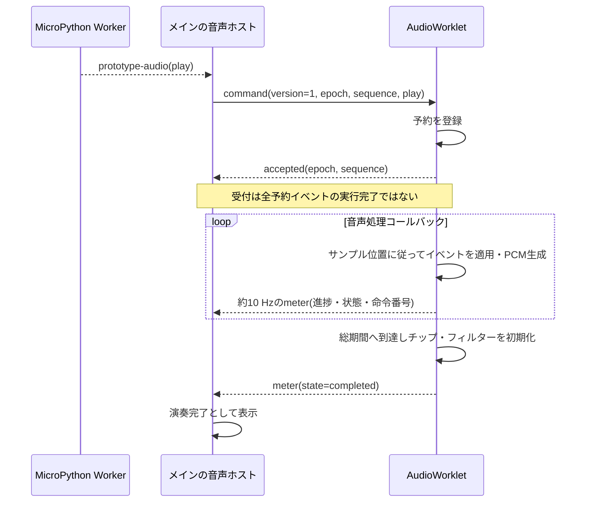

`YmDeliveryTracker`は送信数・受付済み番号・音声処理に反映された番号を別々に追跡する。
旧世代、未送信の番号、後退する番号・frameは排除する。現在の送信番号より古いメーターは
現在の再生表示を上書きしない。未受付メッセージは256件までで、超過時は停止してエラーにする。

`playing`は処理中、`completed`は自然終了、`stopped`は明示停止を表す。
自然終了では最後の進捗を残し、明示停止では予約と進捗を破棄する。
これらは音声エンジンの状態であり、OS・実スピーカーへの出力完了や可聴音の存在を保証しない。
[ADR 0042](adr/0042-confirm-audio-delivery-and-playback.md)に配送確認の理由を記録している。

### サンプル時計・予約・繰り返し

予約イベントは`[絶対ミリ秒オフセット, レジスタ, 値]`の順序付き列である。
AudioWorkletがplayを受け付けた出力frameを起点として、イベントを出力サンプル位置へ変換する。
同時刻の登録順序を維持し、イベント境界でPCM生成ブロックを区切る。

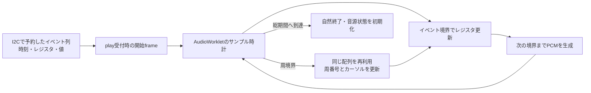

ループ時の位置は次の式で求め、丸めた1周のframe数を毎周加算する方法を避ける。

```text
eventFrame = startFrame
           + round((cycle × loopMs + eventMs) × sampleRate / 1000)
```

1周は100 ms以上、保存するパターンは最大131,071イベント、総期間は最大4,294,967,295 ms（約49.7日）。
同じイベント配列を再利用するため、長い繰り返しほどイベント配列やI2C送信量が増える構成にはしない。
メーターのtotal/applied/pendingは繰り返しを含む累積数で、保存配列の長さとは異なる。

Pythonの正常終了は音声停止条件に含めず、予約演奏はPython終了後も続く。
新しいplayは未適用予約を置き換え、チップの発音状態は維持する。初期化したい場合は先にstopを送る。
予約中の即時writeは予約終了期限を延長しない。予約のない即時制御は最後のwriteから最大約49.7日の期限を持つ。
Python時計・ホスト時計・AudioWorkletの開始時刻の一致は保証せず、即時命令の到着には通信遅延が含まれる。

これは長時間指定を扱える設計であり、49.7日の実時間連続運転や背景再生を検証済みとする意味ではない。
詳しい上限と時計の設計は[ADR 0046](adr/0046-support-long-native-ym2203-playback.md)と
[ADR 0048](adr/0048-enlarge-native-ym2203-reservations.md)を参照する。

### 二つ目のWASMとPCMの処理

メイン側の`YmAudio`が同一オリジンの`ym2203.wasm`を読み込み、`WebAssembly.compile()`したモジュールを
`processorOptions`へ渡す。Workletはホストインポートなしでインスタンス化し、
`fm_init`、`fm_write`、`fm_buffer`、`fm_render`というプロジェクト管理のC++ラッパーを呼ぶ。
これはMicroPython用WASMと別の固定2 MiBメモリを持ち、WASMメモリの自動拡張やファイルシステムを使わない。

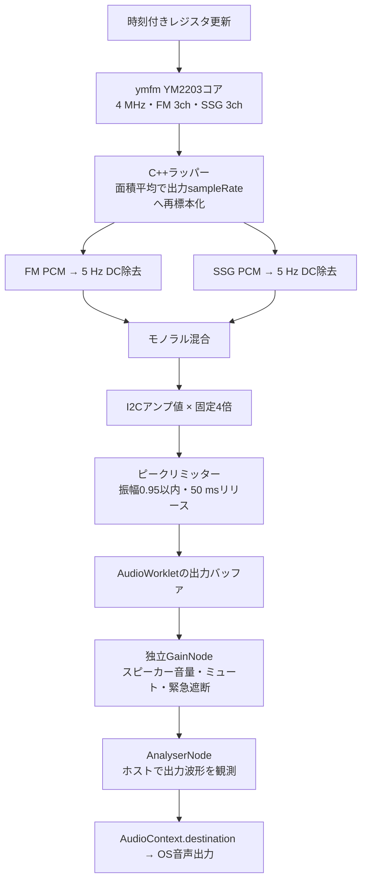

`YmRenderer`はDOM・タイマー・非同期処理を持たず、渡された出力バッファを同期的に埋める。
音源コアは`OPN_FIDELITY_MIN`を使い、ラッパーは最大128サンプルずつFMとSSGの別領域へ生成する。
Worklet内でDC除去、混合、音量倍率、瞬時アタック・50 msリリースのリミッターを適用し、
ホストのGainNodeが最後にスピーカー音量・ミュートを適用する。

FM／SSGメーターは混合前の値で、ホスト表示の波形はGainNode後の出力を観測する。
ミュート時に音源メーターが進みながら出力波形が無音になるのは、この観測位置の違いによる。
`AudioContext.baseLatency`は表示用の遅延目安で、操作から実スピーカーまでの実測値ではない。

音源・再標本化は実験経路で、Timer A/B、BUSY、IRQ、CSM、SSG外部I/O、実DAC・アンプ特性、
実チップとの完全な波形一致は対象外とする。固定コアと再現範囲は
[音源仕様](devices/ym2203-prototype.md#音源と再現範囲)を参照する。

### 結線・ミュート・停止・障害の生存管理

通常画面の`YmAudioPanel`が音声ホストとスピーカー設定を所有する。
結線時にAudioContext、WASM、Workletを準備し、初期ミュート・スピーカー音量60%で開始する。
未接続では音源を準備しない。保存済み結線の復元などでブラウザが開始を保留した場合はクリック待ちを表示し、
pointerdown、keydown、ミュート解除から`resume()`する。クリックだけでミュートを解除しない。

| 操作・事象 | Python・Worker | 音源の予約・時計 | 出力・音声グラフ |
| --- | --- | --- | --- |
| ミュート切り替え・スピーカー音量 | 継続 | 継続 | GainNodeだけを変更。音量設定とミュートを別々に保持 |
| Python正常終了 | readyへ戻る | 予約を継続 | 演奏状態とミュートに従う |
| Python例外・実行エラー | エラー結果等を通知 | 破棄・音源初期化 | 即座にGainを0へする |
| 手動停止 | Workerを破棄 | 破棄・音源初期化 | Gainを0へする。通常画面ではグラフは再利用可能 |
| 再起動・Ctrl+Dリセット・上限超過復旧 | 新しいWorker | 破棄・新停止世代 | Gainを0へする |
| 配線変更・音源切断 | 配線適用の経路で再生成 | 破棄 | 切断ではロード中止・AudioContext終了。再接続は初期ミュート |
| 音源接続中の背景移動 | Workerを停止 | 破棄 | Gainを0へする |
| ページ離脱 | ページの生存期間に従う | 破棄 | 音声グラフを終了 |
| 実行中AudioContextの中断 | Python停止とは別 | 破棄 | 遮断し、再開後は明示的な再演奏が必要 |
| 音源ロード・processor障害 | 配送不能な発音命令はホスト側で停止扱い | 破棄 | 遮断・終了して診断。再接続等で再試行 |

停止はWorkletへstopを送ると同時に、メイン側のGainNodeを即座に0へする。
WorkletやPythonが停止命令をすぐ処理できなくてもホスト側で出力を遮断できる。
`YmDeliveryTracker`の停止世代と、音声ロードの世代、パネルの結線revisionは別々の責務を持つ。
古いメーター、読み込み完了、ミュート解除の非同期完了が新しい結線・演奏を変更しないよう照合する。

ミュート・スピーカー音量は保存データへ追加していない。ページ再読み込みでは初期値へ戻り、
再接続では音量値を維持して初期ミュートへ戻る。同じ結線のパネル再構築ではスピーカー設定を保持する。
音色エディターも同じスピーカー状態を操作する。
[ADR 0043](adr/0043-couple-audio-to-connections-and-separate-speaker-mute.md)に操作と生存管理を記録している。

### Pythonドライバー・MML・BIN・音色エディター

音符や音色を音声ホストへ直接渡すAPIは追加せず、プロジェクト内のPythonライブラリがI2C命令へ変換する。
ライブラリは`/project/lib`へ追加し、通常の保存・import・ZIP経路で扱う。

| ライブラリ | 主な責任 |
| --- | --- |
| `web_lab_ym2203_v1.py` | レジスタ、音符、プリセット、予約演奏の基礎 |
| `web_lab_ym2203_score_v1.py` | 最大6トラックを一つの順序付きイベント列へまとめる |
| `web_lab_ym2203_tone_v1.py` | FMのOP1〜OP4・アルゴリズム・フィードバック、SSGの共有ノイズ・エンベロープ |
| `web_lab_ym2203_mml_v1.py` | 学習用の限定したMMLをイベントへ変換する |
| `web_lab_ym2203_bin_v1.py` | WYM1イベントファイルを検証し、分割してI2Cへ送る |

主要サンプルは発声比較、簡易MML、BINプレイヤーで、合奏・音色設定・Pocket Signalは追加例である。
MMLは各トラック8,192文字・1,024音符／休符、全体4,096レジスタイベントまでとし、既存MML処理系との互換を主張しない。
WYM1は16バイトヘッダーと6バイトの`uint32LE時刻＋レジスタ＋値`を持つ。
BINは2パスで検証・転送し、最大252バイトずつ読むため曲全体をPythonヒープへ展開しない。
これはファイル形式の追加で、I2C・Worker通信・Device API・プロジェクト保存形式の変更ではない。
[ドライバーガイド](devices/ym2203-driver.md)、[WYM1仕様](devices/ym2203-bin-format.md)、
[ADR 0050](adr/0050-organize-ym2203-samples-and-version-event-files.md)を参照する。

音色エディターは設定案をホスト側に持ち、試聴時に固定形式のPythonソースをRuntimeClientへ渡す。
その発音も同じドライバー・I2C・AudioWorklet経路を通る。連続試聴は定期I2C送信をせず、
開始・有効な設定変更時だけ送る。試聴は編集ファイルを上書きしない。
書き出しでは必要なライブラリと新しいPythonの無題タブを用意し、タブは明示保存してからZIPへ含める。
[ADR 0041](adr/0041-add-a-host-owned-sound-patch-editor.md)と
[ADR 0044](adr/0044-add-continuous-i2c-patch-audition.md)に設計を記録する。

ライブラリ追加はコピーしたプロジェクトで容量・パス競合を検査してから適用する。
既知の同梱旧版と全文一致するファイルだけ自動更新し、開いた未編集タブも同期する。
編集済みファイル、未保存変更、module shadowingは自動上書きしない。
競合時に利用者が「バックアップして更新」を選ぶと、元の保存ファイルと下書きを
`ym2203-backups/`へ残して更新する。更新に必要なWorker再生成でimportキャッシュを破棄する。
[ADR 0038](adr/0038-add-a-project-local-sound-driver.md)、
[ADR 0039](adr/0039-reserve-a-multi-channel-score.md)、
[ADR 0040](adr/0040-add-explicit-fm-patches-and-ssg-controls.md)、
[ADR 0047](adr/0047-back-up-conflicting-sound-libraries.md)を参照する。

## ローカルDevice開発

ローカル開発経路は、開発者が信頼するDevice packageを検査後にWorkerへ静的に組み込む。通常ビルドでは
ローカルパスとコードを含めない。複数デバイス構成は、source、期待するDevice ID・版、全ポート接続を
宣言したローカル設定として起動前にまとめて検証する。形式と信頼境界は
[Local Device Configuration v1](local-device-configuration-v1.md)を参照する。

ローカルコードをNode.jsやWorkerで実行する仕組みはセキュリティサンドボックスではない。出所を確認できる
コードだけを対象とし、管理版へ組み込むデバイスとは別の経路として表示する。具体的な手順は
[Device開発ガイド](device-development.md)を参照する。

## オプションコンテンツ境界

通常版のUIは、将来のオプションコンテンツを接続できる小さなno-op境界だけを参照する。公開対象外の
コンテンツ、出典情報、UI、テストを通常バンドルと公開リポジトリへ含めない。将来コンテンツを公開する場合は、
公開許可、形式検証、完全性確認、実行前の利用者操作を別の変更として設計する。

## 配信

本番配信ではCSP、COOP、COEP、CORP、Permissions Policyなどを適用し、WASMとWorkerに必要な権限だけを
許可する。開発サーバー固有のWebSocketやインラインstyle許可を本番へ持ち込まない。設定と確認方法は
[静的配信の準備](deployment.md)を参照する。

AudioWorkletの初期化は安全なコンテキストと対応APIを検査し、HTTPSまたはlocalhostで利用する。
音源ファイルは同一オリジンからロードする。音声生成用WASMはホストインポートを持たず、
利用者のPythonへ任意ネットワーク、DOM、ストレージ全体、汎用JavaScriptを公開しない。
共有メモリ用のクロスオリジン分離とAudioWorklet対応は別の機能条件として扱い、利用できない機能は診断する。

## ビルドと再現性

MicroPythonと音源は別々の固定成果物として管理し、アプリのビルド時にViteが参照先を解決する。
WASMの生成物を直接編集せず、固定ソース・ツールチェーン・外部ラッパー／パッチから再生成する。

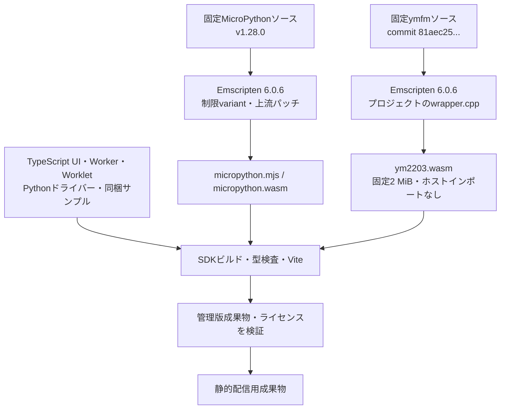

| 対象 | 固定値・正本 |
| --- | --- |
| MicroPython | v1.28.0、commit `e0e9fbb17ed6fd06bb76e266ae554784c9c80804`。[`versions.env`](../runtime/micropython/versions.env) |
| MicroPython固有差分 | `runtime/micropython/variant/`と`runtime/micropython/patches/` |
| ymfm | commit `81aec25ccbb98f4873a255f7551ac4dadac59b4a`。[`versions.env`](../runtime/ymfm/versions.env) |
| 音源ラッパー | [`wrapper.cpp`](../runtime/ymfm/wrapper.cpp)。上流ソースを直接変更しない |
| Emscripten | 両WASMとも6.0.6 |
| Node.js・pnpm | `.node-version`、`package.json`の`packageManager`。リポジトリ内コマンドは`./scripts/use-node.sh`経由 |
| 完全性・ライセンス | 各`artifacts.sha256`、固定LICENSE、[`THIRD_PARTY_NOTICES.md`](../THIRD_PARTY_NOTICES.md) |

音源はBSD-3-Clauseのymfmを使う。第三者通知・ライセンス本文を配信し、成果物のSHA-256と
音源WASMにホストインポートがないことを検証する。既存のAudioWorklet／WASM経路のために
新しい本番npm依存を追加していない。

## 主な資源上限と検証

以下は2026-10-14時点の値である。Pythonの実行時間、音声の演奏期間、共有キュー、
音声命令予算は異なる資源制約で、互いを延長・解除しない。

| 対象 | 現在の上限・条件 | 正本 |
| --- | --- | --- |
| Python実行時間 | α版は既定で無制限。ホスト設定`executionLimitMs`で任意の監視を有効化 | `src/runtime/client.ts` |
| Pythonソース | 200,000文字 | `src/runtime/protocol.ts` |
| 標準出力＋標準エラー | 一入力操作／一スクリプトにつき100,000文字 | `src/runtime/output-buffer.ts` |
| Pythonヒープ | 1 MiB | `src/runtime/micropython.worker.ts` |
| プロジェクト | 内容4 MiB、ファイル・ディレクトリ合計1,024件、相対パスUTF-8で240バイト | `src/project/filesystem.ts` |
| ZIP取り込み | 入力8 MiB、展開後4 MiB、1,024エントリ、15秒 | `src/project/zip.ts` |
| 同期入力キュー／デバッグコマンド | 1キュー／1コマンド4,096バイト | `src/simulation/shared-device-inputs.ts`、`src/runtime/debugger-channel.ts` |
| I2C転送 | 一転送256バイト | `src/simulation/virtual-i2c.ts` |
| 音源予約 | 131,071イベント、総期間1〜4,294,967,295 ms、ループ周期100 ms以上 | `src/audio/ym2203-protocol.ts` |
| 音声命令送信予算 | 一MicroPython Worker世代につき1,024メッセージ、425,981数値 | `src/audio/ym2203-budget.ts` |
| 音声ホスト配送 | 未受付メッセージ256件、初期化応答待ち5秒 | `src/audio/ym2203-audio.ts` |
| 音源WASM | 固定2 MiB、メモリ拡張なし | `scripts/build-ymfm.sh` |

音声送信予算の数値上限は`MAX_YM_EVENTS × 3 + 32,768`である。I2C予約追加のパケット数と、
Workerから音声ホストへ送るメッセージ数は一致しない。停止だけでは累積送信予算を補充せず、
Worker再生成で新しい予算を用意する。長時間ループは追加の定期送信を行わない。

VitestはUIなしで通信、接続、モデル状態遷移、ファイル制限、配送世代、予約サンプル境界、
固定WASMのPCMを検証する。Pythonドライバーは固定MicroPython WASMからI2Cモデル・音源PCMまで検証する。
PlaywrightはブラウザでREPL、停止・復旧、ファイル保存、音源接続、ミュート、予約、音色エディター、
大容量予約、音源ロード失敗等を確認する。自動PCM・音声グラフ検証は実スピーカーでの聴感評価を代替しない。

リポジトリで定義した主要コマンドは次のとおり。図の表示はMermaid対応ビューアーで確認する。

```sh
./scripts/use-node.sh pnpm test
./scripts/use-node.sh pnpm build
./scripts/use-node.sh pnpm test:e2e
./scripts/use-node.sh pnpm test:notices
./scripts/use-node.sh pnpm check
```

時限監視を既定で無効にしたため、無限ループの自動CPU時間封じ込めは保証しない。
手動停止、出力量上限、固定メモリ、ファイル容量、通信容量の制限を維持する。
音源も背景移動で停止し、汎用の無期限ストリーミングや実チップの完全互換を対象にしない。
安全性の前提と残る制約は[脅威モデル](threat-model.md)、対応環境と検証範囲は
[ブラウザ検証](browser-compatibility.md)を参照する。

## 主な設計判断

- [ADR 0001: MicroPythonをDedicated Web Worker内で実行する](adr/0001-run-micropython-in-web-worker.md)
- [ADR 0009: REPL表示と入力状態を分離する](adr/0009-accept-input-inside-the-repl-terminal.md)
- [ADR 0010: MicroPythonを固定ソースから制限付きでビルドする](adr/0010-build-a-restricted-micropython-runtime.md)
- [ADR 0011: 実行資源の上限をWorker外から強制する](adr/0011-enforce-runtime-resource-limits-outside-the-worker.md)
- [ADR 0012: 同一オリジン中心の制限付き配信ポリシーを適用する](adr/0012-serve-the-lab-with-a-restrictive-security-policy.md)
- [ADR 0028: 安定版ベースのpdb互換デバッグ実行を追加する](adr/0028-add-a-stable-pdb-compatible-debug-mode.md)
- [ADR 0030: 小さな型付きカタログでUIを多言語化する](adr/0030-localize-the-ui-with-a-small-typed-catalog.md)
- [ADR 0031: ビューポートへ追従するワークベンチを使う](adr/0031-use-a-viewport-responsive-workbench.md)
- [ADR 0032: 停止位置と上限付きグローバル変数を表示する](adr/0032-show-debug-location-and-bounded-globals.md)
- [ADR 0035: 永続化するプロジェクトファイルシステム](adr/0035-add-a-persistent-project-filesystem.md)
- [ADR 0036: エディタ色分けとブレークポイント表示](adr/0036-add-editor-highlighting-and-breakpoint-markers.md)
- [ADR 0045: α版の既定実行時間を無制限にする](adr/0045-disable-the-default-execution-deadline-for-alpha.md)
- [ADR 0049: I2C FM音源の実現性検証用音声経路](adr/0049-prototype-i2c-fm-audio.md)
- [ADR 0037: 通常ワークスペースの任意接続音源](adr/0037-integrate-an-opt-in-sound-module.md)
- [ADR 0042: 音源命令の配送確認と再生状態](adr/0042-confirm-audio-delivery-and-playback.md)
- [ADR 0043: 結線連動のオーディオとスピーカーミュート](adr/0043-couple-audio-to-connections-and-separate-speaker-mute.md)
- [ADR 0046: 長時間予約と繰り返し](adr/0046-support-long-native-ym2203-playback.md)
- [ADR 0048: 大容量予約](adr/0048-enlarge-native-ym2203-reservations.md)
- [ADR 0050: MML・BINサンプルとWYM1形式](adr/0050-organize-ym2203-samples-and-version-event-files.md)
